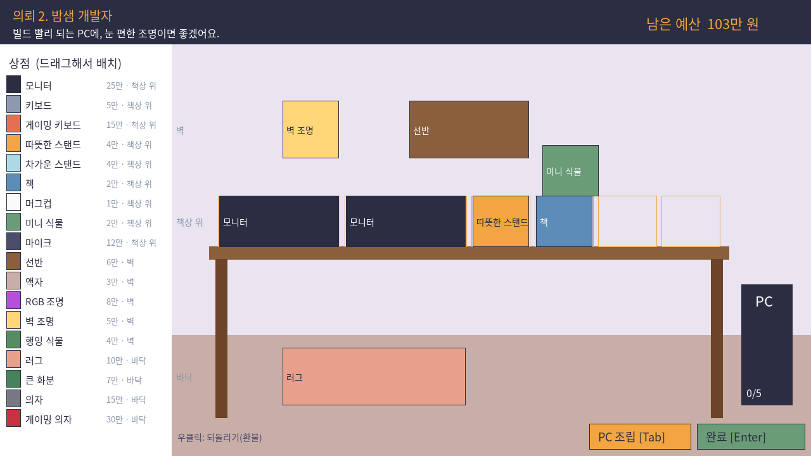

# 데스크테리어 의뢰소

손님의 취향과 예산에 맞춰 **책상을 꾸미고 PC를 조립해 주는** 커스텀 의뢰 게임
2D 게임 프로그래밍 (이대현 교수) 학기 프로젝트 · Python + pico2d · 한준상



## 게임 루프

의뢰 받기 → 쇼핑(소품 + 부품, 한 예산) → PC 조립 → 책상 배치 → 채점 · 해금

## 핵심 재미

- **조합 시너지**: 스탠드 옆에 책을 두면 '독서 콤보'처럼, 위치와 조합에 따라 점수가 오름
- **PC 조립 퍼즐**: 그래픽카드에 돈을 쓰면 꾸밀 돈이 모자라고, 파워 용량이 부족하면 부팅 실패
- **손님 리액션**: 가장 많이 깎인 항목을 손님이 말로 알려 줌

## 채점 (100점)

테마 일치 30 · 필수/금지 20 · PC 성능 20 · 조합 시너지 20 · 예산 절약 10
60점 ★ / 75점 ★★ / 90점 ★★★

## 실행

```bash
pip install pico2d
python main.py
```

조작: 좌클릭 드래그(배치) · 우클릭(되돌리기) · Tab(책상 ↔ PC 조립) · Enter(채점) · ESC(종료)

## 구조

| 파일 | 역할 |
|---|---|
| `main.py`, `game_framework.py` | 실행, 모드 전환 |
| `title_mode.py` → `request_mode.py` → `decorate_mode.py` ⇄ `build_mode.py` → `result_mode.py` | 화면(모드) |
| `room.py` | 벽 · 책상 위 · 바닥 3레이어 슬롯 배치 |
| `scorer.py` | 채점 · 시너지 · 부팅 판정 (`python scorer.py`로 자체 테스트) |
| `state.py` | 의뢰 하나 동안의 배치 · PC · 예산 상태 |
| `data/*.json` | 소품 · 부품 · 의뢰 데이터 (코드 수정 없이 추가) |
| `docs/` | 1차 발표 PPT, 기획서 PPT, 화면 캡처 |

## 진행 현황

- [x] 1차: 기획 · 핵심 루프 프로토타입 (도형 그래픽, 의뢰 3개)
- [ ] 그래픽 교체 (손님 캐릭터는 AI 이미지 생성 툴로 직접 제작)
- [ ] 의뢰 6개 · 소품 24개 · 손님 표정 · 해금
- [ ] 자유 모드 · 저장 · 사운드
